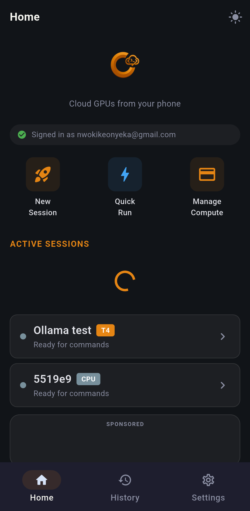
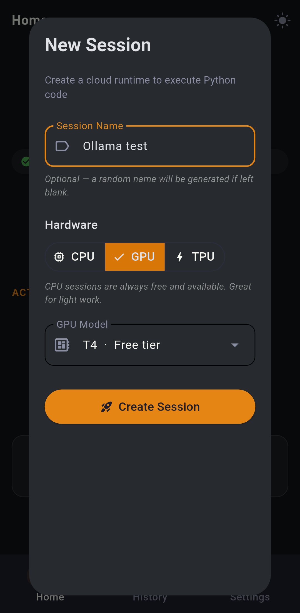
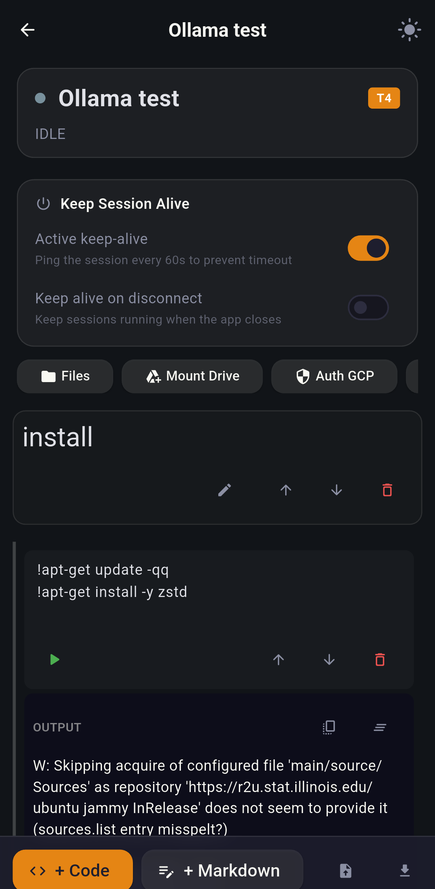
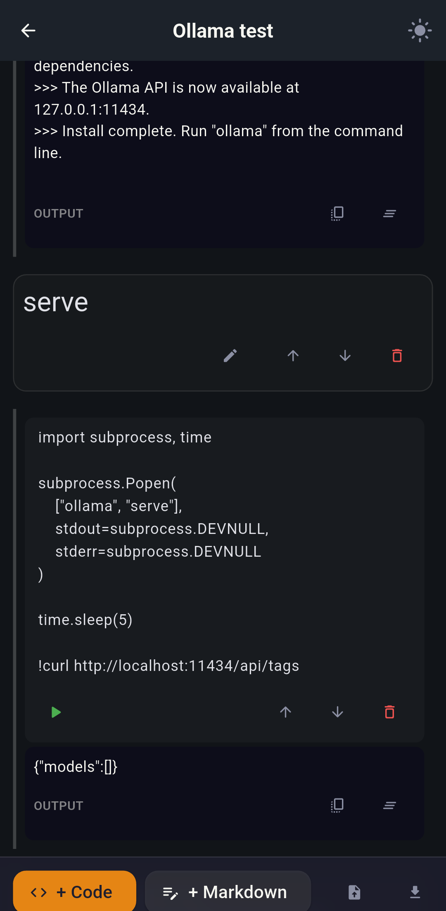
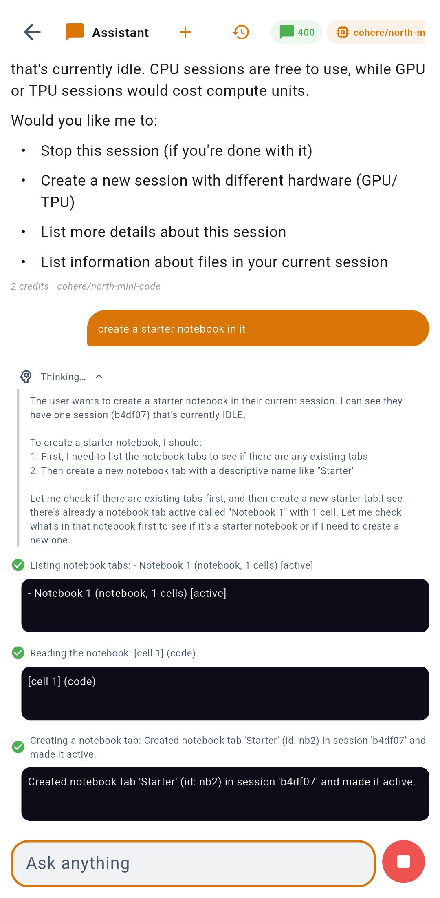
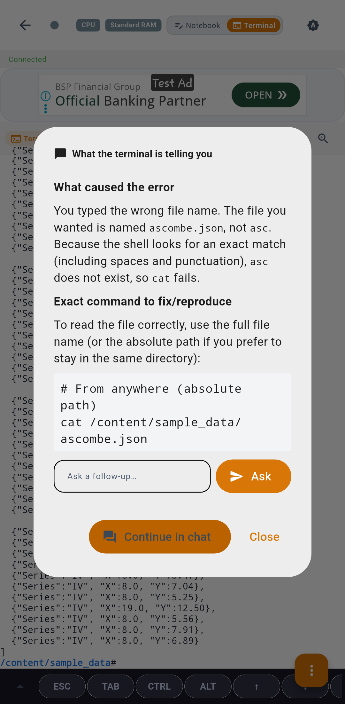
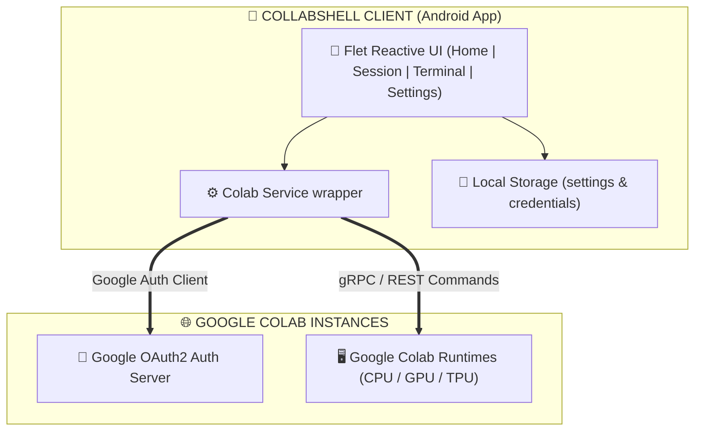

  

  Colab Shell — Run cloud notebooks, interactive terminals & manage files natively on your phone

  
  
  
  
  

---

## Download

| Platform | Download | Notes |
| :---: | :---: | :--- |
| 🤖 **Android** |  | Recommended for Android mobile users |
| 🪟 **Windows** |  | Automated standalone setup installer with desktop shortcut integration |
| 🐧 **Linux (Debian/Ubuntu)** |  | Desktop package tailored for Ubuntu, Debian, Linux Mint & Pop!_OS |
| 🎩 **Linux (Fedora/RHEL)** |  | Desktop package tailored for Fedora, openSUSE, RHEL & CentOS |
| 📦 **Linux (Universal Portable)** |  | Universal standalone portable archive for Arch, Alpine, Steam Deck & all distros |

### Android Architecture Build Splits

| Variant | Download | Notes |
| :--- | :---: | :--- |
| 📱 **ARM64** (most phones) | [**collabshell-arm64-v8a.apk**](https://github.com/Nwokike/ColabShell/releases/latest/download/collabshell-arm64-v8a.apk) | Modern 64-bit Android devices |
| 📱 **ARMv7** (older phones) | [**collabshell-armeabi-v7a.apk**](https://github.com/Nwokike/ColabShell/releases/latest/download/collabshell-armeabi-v7a.apk) | Legacy 32-bit Android devices |

---

## Core Capabilities

| Capability | Description |
| :--- | :--- |
| **Interactive PTY Terminal (TTY)** | Real-time live interactive terminal sessions directly connected via Google Colab's `/api/terminals` WebSocket tunnels. Themes follow the app's light/dark mode, and every terminal starts in `/content`. |
| **Tabbed Workspace** | Seamlessly toggle between **Notebook** cell execution and live **Terminal** shell tabs inside active cloud runtimes. |
| **Session Lifecycle Control** | Instantly create, list, restart, and stop active Google Colab sessions directly from your device with smart intent routing. |
| **Hardware Tiers** | Provision CPU (always free), T4 GPU, or TPU v5e/v6e runtimes based on your Google tier limits. |
| **Native OS File Picker & Transfers** | Save downloaded files and archives anywhere on your device via the native OS File Picker without Android storage permission issues. |
| **Folder Zip-and-Download** | Archive and download entire remote directory structures (`/content/folder`) right to your local device with live sweeping progress bars. |
| **Google Drive & GCP Mounts** | Mount your personal Google Drive storage (`/content/drive`) or propagate Google Cloud credentials with real-time execution progress. |
| **Exportable Event Logs** | Maintain universal history profiles (`storage/history/`) and export session logs as Jupyter Notebooks (.ipynb), Markdown (.md), or plain text. |
| **Sandbox Security** | Secure OAuth2 credentials management sandboxed directly on your device storage. |

## Screenshots

| Home | New session | Notebook | Run output |
|:----:|:-----------:|:--------:|:----------:|
|  |  |  |  |

| Assistant chat | Assistant working | AI notebook tab | Terminal AI |
|:------------:|:---------------:|:-------------:|:-----------:|
|  |  |  |  |

---

## Features

- **Desktop Keyboard Shortcuts (F1 for the cheat sheet)** — Jupyter-standard notebook shortcuts (Shift+Enter run & advance, Ctrl+Enter run in place, Alt+Enter run & insert, Ctrl+S export `.ipynb`), leak-free terminal combos intercepted before the PTY (Ctrl+Shift+T/W/F/L/C/V, Ctrl+Shift+1..9, zoom), and Files shortcuts (F5 refresh, Alt+Up parent, Ctrl+A select all).
- **React-Like Declarative UI (Flet 0.86)** — The entire app is built on Flet's new functional component model (`@ft.component`, `@ft.observable`, `use_state`, `use_effect`): state mutations trigger surgical re-renders instead of full-page repaints.
- **Colab Shell-Branded Design System** — Adaptive light and dark themes styled to the Google Colab branding palette; terminal, cards, and glass surfaces all follow the active mode automatically.
- **Interactive TTY Terminal Emulation** — Dedicated PTY terminal engine connecting directly to Colab WebSocket endpoints (`/api/terminals`), with inline theme cycling, one-tap reconnect, and zoom.
- **Universal Storage & History Normalization** — Monkey-patched backend state persistence (`storage_patch.py`) guaranteeing history and execution logs save reliably across Android and Linux desktops.
- **Native OS File Picker & Zip-and-Download** — Save files anywhere on your OS/Android device without permission headaches, and archive entire cloud folders on the fly.
- **Dynamic Onboarding Guide** — 3-step walk-through onboarding introducing features with gesture-swipe controls.
- **Preloaded Interstitial Ads** — Intelligent Google AdMob integration displaying ads seamlessly on mobile platforms.
- **Non-Blocking Execution** — Asynchronous connection wrappers ensuring the Flet UI stays fully responsive during long remote computations.
- **Tested & Ruff-Compliant** — pytest suite for the shortcut engine and notebook model; clean, formatted, strictly linted codebase.

---

## Architecture

| Layer | Technology | Purpose |
| :--- | :--- | :--- |
| **Frontend** | Flet 0.86 (declarative components) | Cross-platform React-like UI with observable state models and surgical re-renders |
| **Client Service** | `google-colab-cli` SDK | Wrapper for Colab session management and code execution |
| **Local Database** | Flat JSON Storage (`storage.json`) | Key-value store for app settings, theme state, and credentials |
| **Auth Provider** | Google OAuth2 | Secure user authentication to manage personal Google Cloud instances |

### Visual Flow

---

## Privacy & Security

Colab Shell is designed with a strict **Privacy-First** philosophy:

1. **Direct VM Connections**: All commands, file accesses, and script executions are sent directly to Google Colab. No intermediate proxy.
2. **Zero Metadata Tracking**: We do not trace, log, or collect your code, file lists, or Google account credentials.
3. **Device Sandboxing**: Local settings and tokens are kept in secure application directories.
4. **Data Sovereignty**: Saved logs and exports reside 100% locally in your device Downloads folder.

---

## Legal Disclaimer

Colab Shell is an independent Flet-based client application wrapping the Google Colab CLI and is not affiliated with, authorized, maintained, sponsored, or endorsed by Google LLC, Google Colaboratory, or any of its affiliates. 

Users are responsible for complying with Google Colab's Terms of Use, resource usage policies, and local data protection regulations. The authors are not responsible for any issues resulting from Google account suspensions or resource limits.
